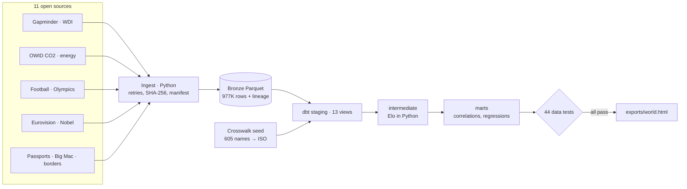

# Connected World

An end-to-end data pipeline that joins **11 open datasets on 170 countries**, from every
international football match since 1872 to Big Mac prices, passports, Nobel prizes, Eurovision
votes, energy and emissions, and asks one question: **which country statistics really move
together once you account for money?**

**Live page: [hani-alnaber.com/connected](https://hani-alnaber.com/connected)**

## What the data says (latest run)

| | |
|---|---|
| Links that are really about income | **60%** of strong correlations between country statistics (77 of 129 pairs with \|ρ\| ≥ 0.5) fall below 0.2 once income is held fixed |
| Links that survive | **47** of 351 pairs tested, after false-discovery control |
| Eurovision | Neighbours give each other **1.9×** the points (5.2 vs 2.7 per final, 1975 to 2022) |
| Olympics | Jamaica won **57** Summer medals (2000 to 2020) where size and income predict about 1; Cuba 125 vs 6 |
| Football | Elo rebuilt from **45,906** matches; Uruguay (3.4M people) is rated 17th in the world |
| Health | US life expectancy is **6.0 years** below what its health spending predicts across 156 countries |
| Emissions | **43** of 149 countries (1M+ people) grew GDP while cutting CO2, 2005 to 2022 |
| Energy | Solar and wind rose from **4.5% to 17.3%** of the world's electricity, 2015 to 2025 |
| Nobel | 277 science laureates worked in the US when they won; 188 were born there |
| Big Mac | A day of GDP per person buys 111 Big Macs at the top of the index and 1.9 at the bottom |

## Architecture



| Step | Tool | What it guarantees |
|---|---|---|
| Ingest | Python (`pipeline/extract.py`) | Retries with backoff, atomic writes, SHA-256 per file in a run manifest |
| Land | Parquet (bronze) | Typed, as delivered, `_source_file` and `_loaded_at` on every row |
| Conform | `dbt/seeds/country_aliases.csv` | Football teams, IOC codes, Eurovision names and historical birthplaces ("Prussia (Poland)") mapped to ISO 3166 alpha-3, generated by `scripts/build_crosswalk.py` |
| Model | dbt + DuckDB | 37 models: 34 SQL, 3 Python (Elo ratings, partial correlations, over/under-performance regressions) |
| Test | dbt tests | Keys, ranges, accepted values, relationships to the country dimension, crosswalk coverage, Elo zero-sum |
| Publish | `pipeline/export.py` | Marts → JSON → one static page; the website never queries the warehouse |
| Orchestrate | Airflow, GitHub Actions | `dags/connected_world_dag.py`, `.github/workflows/refresh.yml` (monthly) |

## Run it

```bash
pip install -r requirements.txt
python -m pipeline all            # extract -> dbt build (models + tests) -> export, about 10 s
python -m pipeline all --refresh  # re-download every source first
```

No source data is stored in this repository: `extract` downloads each source into `data/raw/`
(git-ignored). Only code, the curated crosswalk and indicator catalogue (`dbt/seeds/`) and
aggregated outputs (`exports/`) are committed.

## Method

- **Connections.** For each pair of 27 indicators: Spearman's ρ across countries, then the partial
  rank correlation controlling for GDP per person (both ranks regressed on the income rank,
  residuals correlated). p-values from the t distribution, Benjamini-Hochberg q-values across all
  351 pairs. A link is drawn when q < 0.01, |partial ρ| ≥ 0.30 and at least 60 countries have both
  values. Countries under 500,000 people are excluded.
- **Over/under-performers.** OLS across countries with logged predictors: happiness on income;
  Olympic medals (log 1 + medals) on population and income; Elo on population and income; passport
  power on income; life expectancy on health spending. "Expected" is the fitted value.
- **Football Elo.** eloratings.net method (K by match importance, goal-margin multiplier, +100 home
  advantage), rebuilt from every result since 1872 between teams recognised by FIFA (teams that
  have played World Cup qualifying since 2010). Regional and diaspora sides are excluded.
- **Olympics.** Summer Games 2000 to 2020; team events count once per country; Youth Olympic
  events excluded.
- **Latest values.** Each country uses its latest value from 2015 onwards; projections in source
  series are ignored.

## Sources and licences

Code is MIT-licensed. Data keeps its own licence and is not redistributed here.

| Source | Attribution | Licence |
|---|---|---|
| Gapminder Fast Track | Free data from Gapminder.org | CC BY 4.0 |
| World Development Indicators | The World Bank: World Development Indicators, via Open Numbers | CC BY 4.0 |
| CO2 and energy | Our World in Data (CO2 and Greenhouse Gas Emissions; Energy, from Ember and the Energy Institute) | CC BY 4.0 |
| International football results | Mart Jürisoo, international_results | CC0 1.0 |
| Olympic results | Olympedia.org results, compiled in KeithGalli/Olympics-Dataset | MIT (repository); results are public facts |
| Eurovision votes | TidyTuesday 2022-05-17 (Data.World, eurovision.tv) | Public facts, cited |
| Nobel laureates | Nobel Prize data (nobelprize.org) via TidyTuesday 2019-05-14 | CC0 |
| Passport Index | imorte/passport-index-data, February 2026 | MIT |
| Big Mac index | The Economist | CC BY 4.0 |
| Borders and languages | mledoze/countries | ODbL 1.0 (aggregate use only) |

Changes: data is filtered, mapped to ISO codes and aggregated; derived statistics are my own.

## Data use and accuracy

- **Aggregates only.** The page and exports show country-level aggregates and model outputs. No
  personal data is used.
- **Association, not cause.** Correlations and model residuals describe patterns across countries;
  regional history and other shared factors can sit behind a link.
- **Not official statistics.** Figures are my own aggregations of public data, provided as-is;
  where they differ, the publishers' figures prevail. Country names follow the source data.
- **No endorsement.** Independent portfolio project, not affiliated with or endorsed by any data
  publisher.
- **Corrections.** Found an error? Email hanialnaber@gmail.com.

---
Built by [Hani Al Naber](https://hani-alnaber.com), data engineer.
